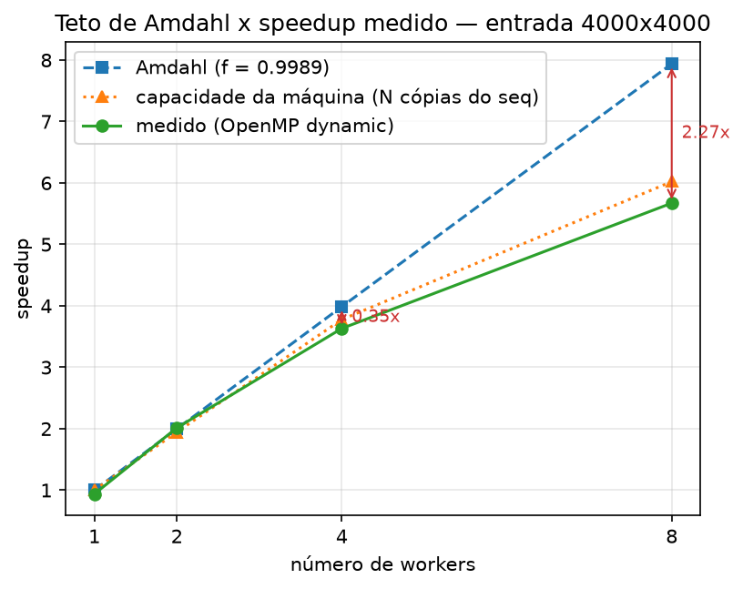
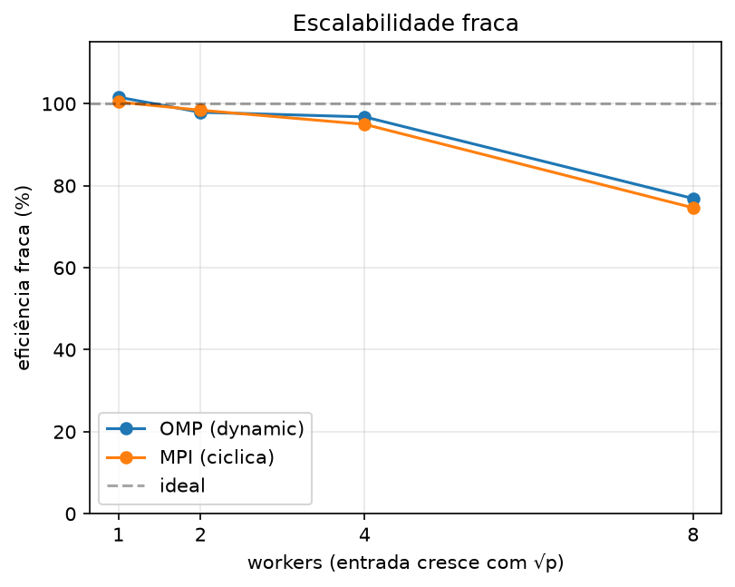

# Marco 2 — Análise experimental

> **Versão preliminar.** Medições de 29/10/2026, no contêiner oficial rodando num MacBook Air.
> Validação refeita em 12/11/2026. As medições definitivas serão refeitas na máquina do
> laboratório (Seção 8).

## 1. Identificação

| Integrante | Matrícula | Frente |
|---|---|---|
| Gabriel Henrique Kuhn Paz | 2612130027 | Baseline e perfilamento + MPI |
| Lara Alves | 2322130053 | OpenMP |

Problema nº 3 — Conjunto de Mandelbrot. Turma CCONM3B, Programação Paralela (CCO085), IESB
2026/2.

## 2. Ambiente e protocolo

| Item | Valor |
|---|---|
| Contêiner | `iesb/pp-lab:2026.2` — Ubuntu 24.04, g++ 13.3.0, Open MPI 4.1.6 |
| `nproc` | 10 |
| Hospedeiro | MacBook Air M4: 4 núcleos de desempenho + 6 de eficiência, sem ventoinha |
| Flags | `-O2 -Wall -std=c++17 -ffp-contract=off` |
| Protocolo | 5 repetições após 1 aquecimento descartado |
| Entradas | forte: 1000², 2000² e 4000² (`max_iter` 1000); fraca: lado 1000·√p; teto: 4000² |
| Duração | 14 min 48 s |
| Reprodução | `./scripts/validar.sh` e `./scripts/medir.sh` no contêiner; `scripts/graficos.py` fora |

**Cronômetro.** Os três programas medem a partir do início do cálculo. A alocação e a soma
final, que são os 0,11% seriais do perfil, ficam fora. No MPI o tempo inclui a coleta da
imagem no rank 0. Na decomposição cíclica, a reordenação das linhas no rank 0 acontece depois
do cronômetro: 5 ms em 4000² com 8 processos, 0,5% do tempo.

**Fração paralelizável** remedida com `--perfil`: `f = 0,9989` em 3 de 4 execuções. A
primeira, a frio, deu 0,9968 — é o caso que o aquecimento descartado existe para cobrir.

**Ruído.** A mediana do desvio relativo entre repetições é 1,9%. Execuções de um worker só,
que fazem o mesmo trabalho, variam de **5,62 a 6,08 s** conforme o que rodou antes: as mais
lentas vêm logo depois de rodadas com 8 workers, o que é compatível com o chip aquecido. Esse
±4% é o limite de resolução das comparações abaixo. É por isso que o OpenMP com 2 threads
aparece com 100,7% de eficiência: está dentro do ruído, não é superlinearidade.

Contra a campanha de 23/09 do Marco 1: 65 configurações em comum, diferença mediana de
+0,5%. Os gráficos de `resultados/` são desta campanha. O PDF do Marco 1 traz os de 23/09,
por isso cita 5,82× onde aqui aparece 5,67×.

## 3. Corretude

`./scripts/validar.sh` compara a matriz de iterações inteira, elemento a elemento, contra o
baseline, e confere o `checksum` impresso. Revalidado em 12/11/2026 no contêiner oficial:

| Verificação | Resultado |
|---|---|
| 11 entradas, cada uma com 1 a 16 threads nas três políticas e 1 a 10 processos nas duas decomposições | 440 de 440 idênticas |
| OpenMP com 10 threads, 200 execuções seguidas | 200 de 200 idênticas |
| AddressSanitizer e UBSan nas três versões | nenhum erro |
| Campanha de 29/10: um único `checksum` por entrada | 8 de 8 |

As 11 entradas cobrem imagens quadradas (1000², 1414²), retangulares (1500 × 1000 e
1000 × 1500), dimensões primas (997 × 1009), imagens com menos linhas que processos (7 × 5,
3 × 2 e 1 × 1) e `max_iter` de 1 e de 5000. Em 1414² a altura não divide por 3, 4 nem 8, o
que exercita as faixas desiguais do `MPI_Gatherv`.

**A validação detecta a condição de corrida.** Compilamos o OpenMP sem o
`reduction(+:checksum)`: com 8 threads, o `checksum` saiu errado em 20 de 20 execuções, com a
matriz correta em todas. É por isso que o script confere os dois. A matriz sozinha não
acusaria esse erro.

## 4. De onde vem a lacuna de Amdahl

No Marco 1, Amdahl previa 7,94× com 8 workers, medimos 5,82×, e atribuímos a diferença
principalmente ao desbalanceamento residual. **A medição desta bateria mostra que não é
isso.**

**O experimento.** `medir.sh` agora roda N cópias independentes do sequencial ao mesmo
tempo, na entrada 4000². Não há comunicação, sincronização nem divisão de trabalho: cada
cópia resolve o problema inteiro. Numa máquina com N núcleos iguais e livres, cada cópia
levaria o mesmo tempo de uma sozinha. A soma das velocidades, `Σ T₁/Tᵢ`, é o speedup máximo
que esta máquina entrega a N workers perfeitos: a **capacidade da máquina**.

| N cópias | Tempo de cada cópia | Mais lenta ÷ mais rápida | Capacidade |
|---|---|---|---|
| 1 | 5,77 s | — | 1,00× |
| 2 | 5,93 s | 1,00 | 1,95× |
| 4 | 6,11 s | 1,00 | 3,78× |
| 8 | 7,67 s | 1,02 | **6,02×** |

Com 8 cópias, **todas** ficam 33% mais lentas, por igual. Isso é compatível com o hospedeiro:
o M4 tem só 4 núcleos de desempenho, então a partir do 5º worker ocupado o trabalho passa a
dividir núcleos de eficiência; e, sem ventoinha, o chip baixa a frequência sob carga
contínua. O experimento não separa as duas causas. Mede a soma.

**A decomposição** (entrada 4000², `f = 0,9989`):

| P | Amdahl | Capacidade da máquina | OpenMP `dynamic` | Lacuna | Hardware | Paralelização |
|---|---|---|---|---|---|---|
| 4 | 3,99× | 3,78× | 3,63× | 0,35× | 0,21× | 0,14× |
| 8 | 7,94× | 6,02× | 5,67× | **2,27×** | **1,92× (85%)** | 0,35× (15%) |

**85% da lacuna em P = 8 é a máquina.** A parcela que sobra para a paralelização (0,35×,
6%) tem o tamanho do ruído entre execuções de um worker (±4%): com esta máquina, ela é
indistinguível de zero.

Ressalva: o teto foi medido no fim da campanha, com o chip já quente, o que pode inflar a
parcela do hardware. Refazer no laboratório resolve as duas coisas.

**O MPI confirma pelo outro lado.** A decomposição cíclica com `np = 8` levou 0,984 s, dos
quais 44 ms no `MPI_Gatherv`. Sem eles, o speedup seria 5,622 ÷ 0,940 = **5,98×**, a 1% da
capacidade da máquina. A distância do MPI até o teto é a comunicação.

## 5. Banda de memória

O laço de escape não toca a memória: `z`, `c` e o contador ficam em registradores. Cada pixel
faz em média `k̄ ≈ 172` iterações e só então escreve um inteiro de 4 bytes.

| Execução | Escrito | Tempo | Banda usada |
|---|---|---|---|
| OpenMP `dynamic`, 8 threads, 4000² | 64 MB | 0,991 s | 65 MB/s |
| 8 cópias do sequencial | 512 MB | 7,73 s | 66 MB/s |

A memória do M4 sustenta 120 GB/s (especificação da Apple); o programa usa menos de 0,1%
disso. **Banda de memória não é fator neste problema.** Ele é limitado por cálculo, e é por
isso que a perda do hardware aparece inteira no teto da máquina.

## 6. Comunicação e desbalanceamento no MPI

Entrada 4000²:

| Decomposição | `np` | Tempo (s) | Speedup | Eficiência | Desbalanceamento | Comunicação |
|---|---|---|---|---|---|---|
| bloco | 2 | 2,932 | 1,92× | 96% | 1,00× | 17 ms |
| bloco | 4 | 3,097 | 1,82× | 45% | 40,61× | 3 021 ms |
| bloco | 8 | 2,851 | 1,97× | 25% | **839,19×** | 2 848 ms |
| cíclica | 2 | 2,984 | 1,88× | 94% | 1,00× | 18 ms |
| cíclica | 4 | 1,550 | 3,63× | 91% | 1,01× | 21 ms |
| cíclica | 8 | 0,984 | **5,71×** | 71% | 1,04× | 44 ms |

- **Blocos não escalam.** De 2 a 8 processos o speedup fica em torno de 2×. Com 8 faixas, o
  rank mais lento calcula por 839 vezes o tempo do mais rápido: as faixas das bordas caem
  quase inteiras fora de `M` e terminam em poucas iterações.
- **Os 3 s de "comunicação" não são transferência.** O volume é o mesmo da cíclica, 64 MB.
  São os ranks rápidos parados no `MPI_Gatherv` à espera do lento. O campo
  `desbalanceamento` separa as duas coisas (Marco 1, Seção 6.2).
- **O custo real de comunicação cresce com `np`.** Na cíclica, de 18 a 44 ms entre 2 e 8
  processos. Em `np = 8` são 4,5% do tempo, exatamente a distância até a capacidade da
  máquina (Seção 4).

## 7. Escalabilidade fraca

O lado cresce com `√p`, então o trabalho por worker fica constante: `k̄` não depende da
resolução (172,3, 172,5 e 172,5 no Marco 1). Eficiência fraca = `T_base / T_p`, com
`T_base` o sequencial em 1000².

| p | Lado | OpenMP `dynamic` | MPI cíclica | `Gatherv` |
|---|---|---|---|---|
| 1 | 1000 | 101,6% | 100,4% | 1 ms |
| 2 | 1414 | 97,9% | 98,4% | 3 ms |
| 4 | 2000 | 96,8% | 95,0% | 7 ms |
| 8 | 2828 | 76,9% | 74,6% | 28 ms |

- A curva é plana até 4 e cai em 8 para **cerca de 75%: a mesma eficiência que a máquina
  entrega a 8 cópias independentes** (6,02 ÷ 8). No MPI, o cálculo por processo sobe de
  0,367 s para 0,489 s (+33%), a mesma desaceleração das cópias da Seção 4.
- A comunicação do MPI cresce com `p` (de 1 a 28 ms) porque a imagem reunida no rank 0
  cresce com `p`. É ela que deixa o MPI cerca de 2 pontos abaixo do OpenMP em `p = 8`.
- Os valores acima de 100% em `p = 1` são ruído.

## 8. Pendências

- **OpenMP**, frente da Lara Alves: discussão de *false sharing* no vetor da imagem e da
  comparação entre políticas com os números desta bateria (8 threads: `static` 2,73×,
  `dynamic` 5,67×, `guided` 3,78×).
- **Laboratório:** repetir `validar.sh` e `medir.sh` na máquina do laboratório. O teto da
  máquina vai junto e mostra quanto da lacuna sobra lá.
- **Código sequencial oficial:** `src/seq/` ainda é provisório. Quando o oficial chegar, a
  bateria inteira se repete.
